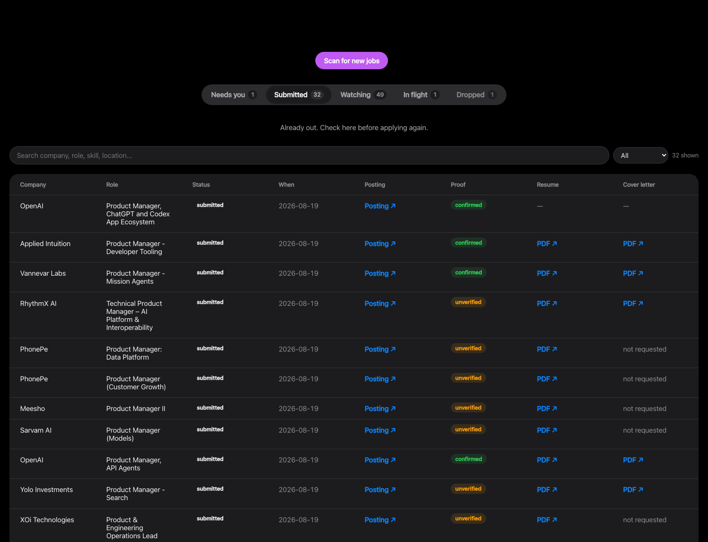
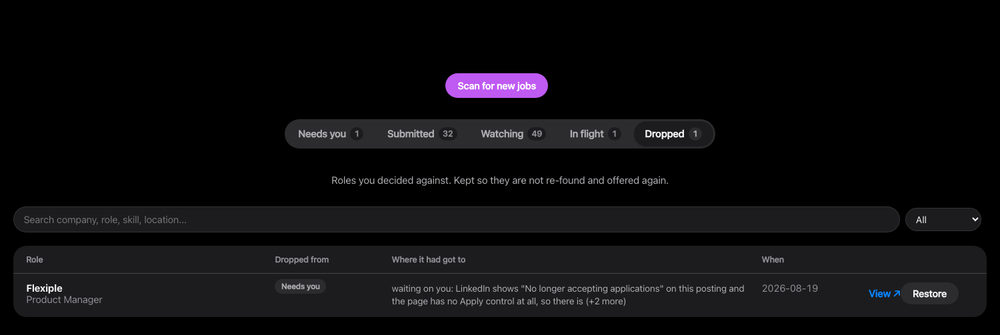

<div align="center">


**I stopped applying to jobs myself. A Claude agent does it now.**

One tailored resume and cover letter per posting. Forms filled and submitted end to end.
A board that tells me the truth about what is actually happening.

`MIT` · `Claude Skill` · `macOS`

</div>

---

Jobby is a [Claude Skill](https://docs.claude.com/en/docs/claude-code/skills) plus a small
daemon. Press **Apply** on a role and, about three seconds later, an agent is building a resume
for that specific posting, opening the form in a browser, filling it, and submitting it. When
something genuinely needs a person, it stops and says exactly what and why.

It does not invent anything. Every claim on a generated resume has to trace back to a resume you
wrote, an answer you gave, or a story you told it. Where it cannot answer honestly, it stops.

## The board

Five lanes. Four are work; the fifth is a record of decisions.

### Needs you

Applications that hit something only a person can do: creating an account, typing a password,
clearing a CAPTCHA. Each card says what to do and what doing it buys you. Creating one Workday
account unblocks every future role at that company, because the agent's browser keeps the session
and the saved password.


**Retry** re-runs the agent once you have cleared the blocker: it reuses the documents already
built and picks up at the form. **Open & finish** raises the tab the agent left behind, with the
form still filled, rather than opening a fresh copy of the application.

### Watching

Roles it found, newest first, with the experience bar, the location, the core skills, and an
honest read on how you line up, including where you fall short. **Apply** starts the pipeline.
The **×** drops the role.


### Submitted

What actually went out, with the exact resume and cover letter each employer received. Nothing
reaches this lane without a confirmation quoted off the page after submitting. Not "the click
succeeded", the words the site showed.



### In flight, and Dropped

**In flight** shows live progress through building documents, filling, submitting and verifying,
and lets you **Stop** a run mid-form. **Dropped** is what you said no to, and it records the lane
it came from and how far it had got: *not started*, *waiting on you: create a Workday account*, or
*Filling the form (14 of 18 fields)*.



## What makes it different

**A resume and a cover letter per posting.** Never a reused file. It clones your existing layout
exactly and rewords only the content. Before either is uploaded, `scripts/resume_pdf.py verify`
diffs the rebuilt PDF against your original and fails on a changed margin, a missing accent
colour, or a font size with no counterpart. Content is checked separately: employers, dates,
titles and numbers all have to trace back to your real resume.

**One application per job description, enforced.** Not audited afterwards, blocked before the
browser opens. The same posting reaches a watch list under different ids depending on where it was
found, so the guard matches on application id, on normalised company and role, and on the posting
URL with tracking stripped.

**It stops rather than guesses.** No account creation, no passwords, no one-time codes, no
CAPTCHAs, and no ticking a truth attestation on a form where anything was inferred. Those land in
Needs you with the exact clause quoted.

**Region-aware.** Indian postings get the India resume and phone; US postings get the US ones.
Your street address goes into application forms when they ask, and never onto a resume header.

## Setting it up

```bash
python3 scripts/store.py init          # create the local store
python3 scripts/publish.py --setup     # link Vercel, set a board password
python3 scripts/watch.py --install     # install the watcher
python3 scripts/queue_check.py --write # prove the queue works end to end
```

The queue lives in Cloudflare Workers KV and the board is served from it. Put these in
`deploy/.env.local`:

```
CF_ACCOUNT_ID=...
CF_KV_NAMESPACE_ID=...
CF_API_TOKEN=...            # scoped to Workers KV Storage: Edit, nothing else
```

Machine-local settings go in `~/.job-application/config.env`, which nothing overwrites:

```
HEALTHCHECKS_URL=https://hc-ping.com/<uuid>
```

Then sign the agent's browser in once, which every later run inherits:

```bash
python3 scripts/browser.py --login https://www.linkedin.com
```

## How it actually works

A page on Vercel cannot start a process on your laptop. So every button queues a request, and
`scripts/watch.py`, running as a launchd agent, reads all the queues in a single call every three
seconds and spawns the agent that does the work. A click reaches a running agent in about three
seconds.

Runs are spawned detached and tracked by a pid lock file. One application at a time, and a
forty-five minute run never freezes the board. A dead pid releases the lock on its own, so a
runner killed mid-flight cannot wedge the pipeline.

Spawned CLI sessions have no browser of their own, so they attach over CDP to a long-lived Chrome
with a persistent profile. That is what makes a parked application resumable: form values live in
the page, not the profile, so a browser that dies with its run takes every filled field with it.

Everything the watcher does is reported to [healthchecks.io](https://healthchecks.io), failures
included. The point is the silence. If the process dies, the pings stop and you hear about it.

## Things it learned the hard way

Each of these is a comment in the code, because each cost real time:

- launchd gives an agent `PATH=/usr/bin:/bin:/usr/sbin:/sbin` and nothing else. Homebrew is
  invisible. Every queue read died for hours while the watcher logged healthy cycles, because a
  crashed check and an empty queue both exit non-zero.
- `vercel` and `npx` are `#!/usr/bin/env node` scripts. An absolute path does not save you: `env`
  resolves `node` against the child's PATH.
- Free tiers price *listing* a collection far more harshly than reading a key. Workers KV allows
  100,000 reads a day and 1,000 list requests, so the whole queue lives under one key.
- Publishing the board used to redeploy the site. Vercel allows 100 deploys a day and one
  application reports six phases. The board is served from KV now; deployments carry only code.
- A worker that processes one item must delete one item. `claim` once destroyed fourteen queued
  Apply clicks after running the first.

## What it will not do

Solve CAPTCHAs. Create accounts or type passwords. Read one-time codes. Tick a truthfulness
attestation on a form where anything was inferred. Agree to a binding legal document you have not
authorised. Invent an answer to a required field.

## Tests

```bash
python3 -m pytest tests/ -q
```

101 tests, including `node --test` coverage of the queue logic run from inside the Python suite,
so the JavaScript cannot drift.
